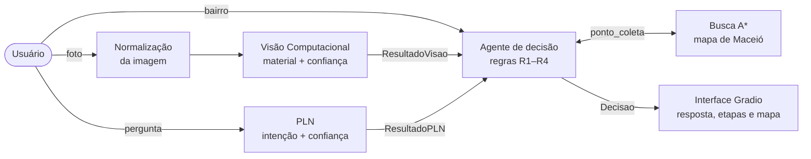
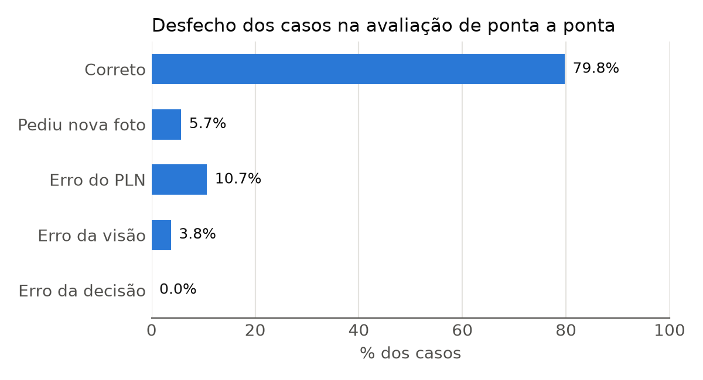
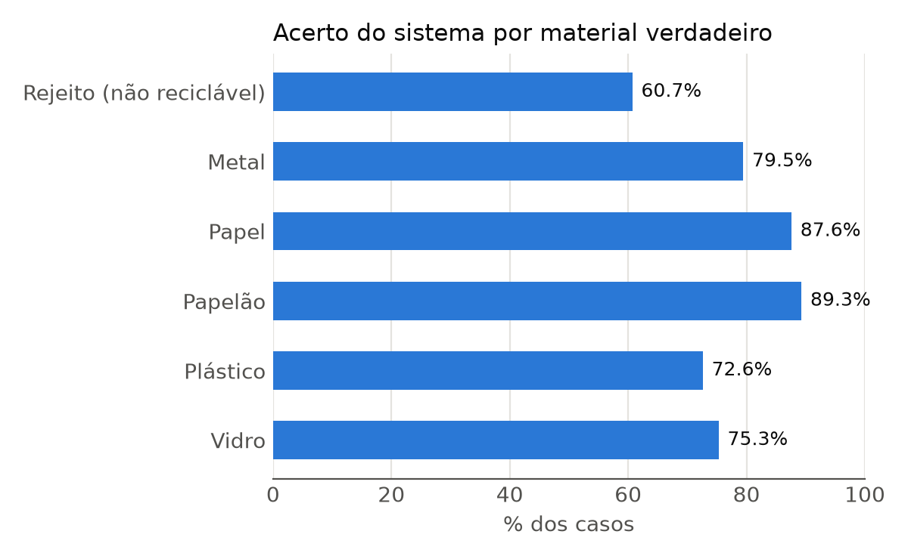

# EcoTriagem

Assistente de descarte de resíduos que combina **Visão Computacional**, **Processamento
de Linguagem Natural (PLN)**, **Machine Learning** e um **agente de decisão com busca
heurística**. O usuário envia a foto de um resíduo, pergunta em linguagem natural o que
quer saber ("isso é reciclável?", "onde fica o ecoponto mais perto?") e recebe uma
resposta contextualizada: material identificado, lixeira correta segundo a coleta
seletiva, preparo antes do descarte e rota até o ponto de coleta mais próximo.

Projeto Integrador Final da disciplina de Inteligência Artificial — AFYA / UNIMA Maceió.

> **Situação atual:** todos os módulos (Visão, PLN, decisão, busca, integração e
> interface) estão implementados e avaliados, individualmente e no fluxo completo
> (79,8% de acerto de ponta a ponta). Falta a avaliação com fotos reais tiradas pela equipe.

## Integrantes

| Integrante | Responsabilidade |
|---|---|
| Matteus | Visão Computacional e Machine Learning (classificador de imagens) |
| Andrey | Processamento de Linguagem Natural (classificador de intenções) |
| Caio | Agente de decisão e busca (regras e A\*) |
| Frederico | Integração dos módulos e interface web |
| Edvaldo | Documentação, artigo científico e README |

> Os nomes completos de cada integrante devem constar aqui na entrega final
> (seção 12 do enunciado).

A divisão detalhada de tarefas está em [`PLANO_DE_TRABALHO.md`](PLANO_DE_TRABALHO.md).

## Problema

**Problema abordado:** a separação correta dos resíduos domésticos depende de o
cidadão saber de que material é cada objeto, se ele é reciclável, em qual lixeira
da coleta seletiva deve ir, como prepará-lo e onde entregá-lo. A Política Nacional de
Resíduos Sólidos [7] prevê a coleta seletiva e a responsabilidade compartilhada pelo
ciclo de vida dos produtos, e a Resolução CONAMA nº 275/2001 [6] define o código de
cores dos coletores. Na prática, porém, essas informações ficam dispersas, e a dúvida
surge na hora do descarte, com o objeto na mão. O erro de separação contamina material
reciclável e faz resíduos aproveitáveis terminarem no lixo comum.

**Público-alvo:** moradores que separam o lixo em casa e têm dúvidas pontuais de
descarte. O mapa de pontos de coleta usa como cenário a cidade de Maceió (AL).

**Objetivo:** desenvolver uma aplicação funcional que, a partir de uma foto do resíduo
e de uma pergunta em linguagem natural:

1. identifique o material do resíduo por classificação de imagens (Visão Computacional e ML);
2. reconheça a intenção da pergunta com um classificador de texto treinado (PLN e ML);
3. combine as duas informações num agente baseado em regras, que decide entre responder,
   pedir outra foto ou pedir que a pergunta seja reformulada;
4. indique a lixeira correta (CONAMA 275/2001), a reciclabilidade e o preparo do resíduo;
5. encontre, por busca A\*, o ponto de coleta mais próximo que aceita aquele material.

## Tecnologias

- **Linguagem:** Python 3.13.5
- **Visão computacional:** PyTorch e torchvision (MobileNetV2 pré-treinada no
  ImageNet, ajustada ao TrashNet) e Pillow (normalização das imagens: orientação EXIF,
  transparência, conversão para RGB e redimensionamento).
- **Processamento de linguagem natural (PLN):** scikit-learn [4], com TF-IDF [5] de
  palavras e de n-gramas de caracteres e Regressão Logística; pré-processamento
  próprio (normalização, tokenização e stopwords com as negações preservadas).
- **Machine Learning:** scikit-learn (modelos, validação cruzada estratificada e
  métricas) e joblib (persistência dos modelos treinados).
- **Tomada de decisão:** sistema baseado em regras e busca A\*, busca gulosa, BFS e
  custo uniforme, implementados em Python puro.
- **Interface:** Gradio 6 [8].
- **Gráficos:** Matplotlib.
- **Testes:** pytest.
- **Ferramentas de desenvolvimento:** Git e GitHub.

As dependências estão em [`requirements.txt`](requirements.txt). Nenhum serviço pago,
API externa ou GPU é necessário.

## Arquitetura

Visão e PLN atuam **no mesmo fluxo** (requisito 4.5 do enunciado): a foto é analisada
uma única vez, e cada pergunta do usuário passa pelo PLN e pelo agente de decisão,
reaproveitando a análise da imagem.



Os módulos se comunicam por **contratos** definidos em
[`src/integracao/contratos.py`](src/integracao/contratos.py): `ResultadoVisao`,
`ResultadoPLN`, `RotaColeta` e `Decisao`. O vocabulário comum (classes de resíduo,
intenções e limiares de confiança) fica em [`src/configuracao.py`](src/configuracao.py).

```text
src/
├── configuracao.py       # Classes, intenções e limiares usados por todos os módulos
├── visao_computacional/  # Classificação do resíduo a partir da imagem
├── pln/                  # Dataset, treino, avaliação e inferência do classificador de intenções
├── machine_learning/     # Dataset de imagens, baseline clássico, treino e avaliação da MobileNetV2
├── decisao/              # Agente de regras, busca A* e mapa simulado
└── integracao/           # Contratos, pipeline, normalização de imagens, avaliação de ponta a ponta
```

## Estrutura do repositório

```text
.
├── README.md
├── PLANO_DE_TRABALHO.md
├── requirements.txt
├── pytest.ini
├── app.py                     # Interface web (Gradio)
├── src/                       # Código-fonte (ver Arquitetura)
├── notebooks/                 # Análises exploratórias
├── dados/
│   ├── brutos/                # TrashNet baixado pelo script (fora do git)
│   ├── processados/           # Divisão treino/validação/teste (CSV versionado)
│   ├── exemplos/              # Uma imagem por classe, do conjunto de teste, para a interface
│   ├── pln/                   # Dataset de intenções (399 frases)
│   ├── avaliacao/             # Perguntas de teste da avaliação de ponta a ponta
│   └── mapa/                  # Mapa simulado de Maceió e pontos de coleta fictícios
├── modelos/                   # Modelos treinados (versionados; regeneráveis pelos scripts)
├── resultados/
│   ├── metricas/              # Métricas em JSON/CSV
│   ├── graficos/              # Figuras para o artigo
│   └── exemplos/              # Exemplos de entrada e saída
├── testes/                    # Testes automatizados (pytest)
└── artigo/                    # Rascunhos e fonte do artigo
```

## Instalação

### Pré-requisitos

- Python 3.13.5
- Git
- pip
- Cerca de 50 MB livres para o dataset de imagens

### Preparar o ambiente

Clone o repositório e entre na pasta:

```bash
git clone https://github.com/edvaldo-f/EcoTriagem.git
cd EcoTriagem
```

Crie e ative um ambiente virtual.

**Windows (PowerShell):**

```powershell
python -m venv .venv
.venv\Scripts\Activate.ps1
```

**Linux/macOS:**

```bash
python3 -m venv .venv
source .venv/bin/activate
```

Instale as dependências:

```bash
python -m pip install --upgrade pip
python -m pip install -r requirements.txt
```

## Execução

Todos os comandos são executados **a partir da raiz do repositório**, com o ambiente
virtual ativado.

### Reprodução completa, do zero

```bash
python -m src.machine_learning.baixar_dados   # baixa o TrashNet (~43 MB) e confere o SHA-256
python -m src.machine_learning.treinar        # treina o classificador de imagens (~5 min)
python -m src.pln.treinar                     # treina o classificador de intenções
python app.py                                 # abre a interface em http://127.0.0.1:7860
```

Os modelos treinados já estão no repositório, em `modelos/` (classificador de imagens,
cerca de 9 MB, e classificador de intenções), então **a interface roda direto com
`python app.py`**, sem treinar nada. Os comandos de treino acima regeneram os modelos a
partir dos dados. O download do TrashNet só é necessário para treinar e para os
experimentos; as fotos de exemplo da interface já estão no repositório. Se um modelo
for apagado, o módulo avisa no console e usa um substituto provisório: a visão devolve
um resultado fixo e o PLN usa o baseline de palavras-chave.

### Dados de imagem

```bash
python -m src.machine_learning.baixar_dados    # dados/brutos/trashnet/
python -m src.machine_learning.dividir_dados   # dados/processados/divisao_trashnet.csv
```

A divisão já está versionada. Rodar `dividir_dados` de novo gera o mesmo arquivo
(seed fixa).

### PLN — classificador de intenções

```bash
python -m src.pln.treinar    # compara os modelos e salva o melhor em modelos/
python -m src.pln.avaliar    # gera métricas, gráficos e exemplos em resultados/
```

O modelo treinado está versionado em `modelos/pln_intencoes.joblib`; o treino o
regenera com os mesmos resultados (seed fixa). Detalhes em
[`src/pln/README.md`](src/pln/README.md).

### Interface web (demonstração)

```bash
python app.py               # interface normal
python app.py --registrar   # também salva cada pergunta e resposta em resultados/exemplos/interface/
```

Roteiro de demonstração:

1. Envie uma foto (upload, webcam ou área de transferência) ou clique numa foto de exemplo.
2. Escolha **Seu bairro** se for perguntar pelo ponto de coleta.
3. Faça perguntas na conversa, por exemplo: "isso é reciclável?", "qual a cor da
   lixeira?", "preciso lavar antes?", "onde fica o ecoponto mais perto?".
4. Abra **Como o sistema chegou à resposta** para ver a saída de cada etapa: material
   e confiança (Visão), intenção e confiança (PLN), ação e regra aplicada (Decisão) e,
   quando houver, a rota encontrada pela busca, desenhada no mapa.

### Experimentos

```bash
python -m src.decisao.comparar_buscas       # compara A*, busca gulosa, BFS e custo uniforme
python -m src.integracao.avaliar_sistema    # avaliação de ponta a ponta (exige o TrashNet baixado)
```

### Visão Computacional

```bash
python -m src.machine_learning.analise_exploratoria  # distribuição das classes
python -m src.machine_learning.treinar_baseline      # baseline clássico (HSV + HOG e SVM)
python -m src.machine_learning.treinar               # MobileNetV2 em duas fases
python -m src.machine_learning.avaliar               # métricas finais no conjunto de teste
```

O treino lê a divisão de `dados/processados/divisao_trashnet.csv` e salva o modelo em
`modelos/classificador_residuos.pt` (versionado). Sem o arquivo, o sistema continua
funcionando com um resultado fixo e avisa no console. Detalhes em
[`src/visao_computacional/README.md`](src/visao_computacional/README.md).

## Modelos e métodos

### Visão Computacional e dados de imagem

- **Dataset:** TrashNet [1] (licença MIT), versão redimensionada (512×384), com 2.527
  imagens em 6 classes: papel, papelão, plástico, vidro, metal e rejeito.
- **Limpeza:** as imagens foram agrupadas pelo hash SHA-256 do arquivo. Foram
  encontrados 3 pares de imagens idênticas com **rótulos diferentes** (a mesma foto
  como vidro e como metal ou plástico). As 6 cópias foram descartadas, porque não há
  como saber qual rótulo está correto. Restaram 2.521 imagens.
- **Divisão:** estratificada por classe, 70% / 15% / 15% (treino / validação / teste),
  seed 42.
- **Normalização na inferência:** correção da orientação EXIF (fotos de celular),
  composição de imagens com transparência sobre fundo branco (o fundo do TrashNet),
  conversão para RGB e limite de 1024 px no maior lado.
- **Baseline clássico:** histograma HSV (16 bins de matiz, 8 de saturação, 8 de valor)
  concatenado com HOG (células de 16×16, 9 orientações), 608 características, e SVM com
  núcleo RBF e `class_weight="balanced"`. Serve para medir o quanto a rede acrescenta.
- **Classificador:** MobileNetV2 pré-treinada no ImageNet, ajustada em duas fases —
  primeiro só a cabeça classificadora (backbone congelado, 6 épocas), depois ajuste fino
  dos blocos finais (12 épocas, taxa 10× menor e agendador cosseno). Aumento de dados
  apenas no treino; pesos inversamente proporcionais à frequência da classe na entropia
  cruzada, por causa do desbalanceamento. O melhor modelo é escolhido pelo **F1-macro na
  validação**, não pela acurácia, que numa base desbalanceada premia as classes grandes.

### PLN — classificação de intenções

- **Tarefa:** classificação supervisionada da pergunta em 7 intenções: `identificar`,
  `como_descartar`, `e_reciclavel`, `cor_lixeira`, `como_preparar`, `ponto_coleta` e
  `fora_do_escopo`.
- **Dataset:** 399 frases escritas pela equipe ([`dados/pln/intencoes.csv`](dados/pln/intencoes.csv)),
  52 a 58 por intenção, variando registro formal e informal, gírias, ausência de acento,
  erros de digitação, frases curtas e objetos nomeados. Os critérios de rotulagem estão
  em [`dados/pln/README.md`](dados/pln/README.md).
- **Divisão:** 319 frases de treino e 80 de teste (estratificada, seed 42). O teste é
  usado uma única vez, depois de o modelo estar escolhido.
- **Pré-processamento:** minúsculas, remoção de acentos e pontuação, tokenização e
  stopwords, **preservando as negações** ("não", "nunca"), que mudam o sentido da pergunta.
- **Modelos comparados** por validação cruzada estratificada de 5 partes no treino:
  baseline de palavras-chave; TF-IDF de palavras com Regressão Logística; TF-IDF de
  caracteres com Regressão Logística; TF-IDF de palavras e caracteres com Regressão
  Logística ou LinearSVC; e duas ablações do pré-processamento.
- **Modelo escolhido:** TF-IDF de palavras + n-gramas de caracteres com Regressão
  Logística. A confiança devolvida é a probabilidade da intenção prevista.
- **Extra:** [`src/pln/objetos.py`](src/pln/objetos.py) extrai o objeto citado na
  pergunta ("pilha", "caixa de leite") e indica quando ele exige descarte especial.

### Agente de decisão

Agente reativo baseado em regras condição–ação [2]. Ele percebe as saídas da Visão e
do PLN, mantém a análise da foto durante a conversa e escolhe uma ação. As regras são
avaliadas em ordem de prioridade:

| Regra | Condição | Ação |
|---|---|---|
| R1 | Pergunta fora do escopo ou confiança do PLN < 0,5 | Pedir que a pergunta seja reformulada |
| R2 | Confiança da visão no material ≥ 0,6 | Responder sobre o material |
| R3 | Confiança no material < 0,6, mas P(lixeira) ≥ 0,6 | Responder sobre a lixeira |
| R4 | Nenhuma das anteriores | Pedir outra foto |

A heurística da regra R3 calcula a probabilidade de cada lixeira como a **soma das
probabilidades dos materiais que vão nela**. Por exemplo, papel 45% + papelão 30% dá
75% para a lixeira azul. Assim o sistema responde mesmo quando não distingue materiais
que têm o mesmo destino. As cores seguem a Resolução CONAMA nº 275/2001 [6]: azul para
papel e papelão, vermelha para plástico, verde para vidro, amarela para metal e cinza
para rejeito não reciclável. Cada resposta informa a regra aplicada. Documentação
completa em [`src/decisao/REGRAS.md`](src/decisao/REGRAS.md).

### Busca do ponto de coleta

- **Formulação:** os estados são 26 bairros de Maceió, com coordenadas aproximadas,
  ligados por 46 conexões. O estado inicial é o bairro do usuário. O objetivo é
  qualquer bairro com ponto de coleta que aceite o material. O custo de cada ligação é
  a distância em linha reta (fórmula de haversine) multiplicada por um fator de
  tortuosidade ≥ 1.
- **Algoritmos:** A\* [3], busca gulosa, busca em largura (BFS) e custo uniforme, este
  último como referência de caminho ótimo.
- **Heurística:** h(n) é a menor distância em linha reta de n até um bairro objetivo.
  Como cada ligação custa pelo menos a distância em linha reta, h é **admissível e
  consistente**, o que garante a otimalidade do A\*. As duas propriedades são
  verificadas nos testes automatizados para todos os bairros e materiais.
- **Mapa:** [`dados/mapa/maceio_simulado.json`](dados/mapa/maceio_simulado.json). É um
  mapa **simulado**: as coordenadas são aproximadas e os 6 pontos de coleta são fictícios.

### Integração e interface

- **Pipeline** ([`src/integracao/pipeline.py`](src/integracao/pipeline.py)) em duas
  etapas: `analisar_imagem`, executada uma vez por foto, e `responder_pergunta`,
  executada a cada pergunta.
- **Carregamento dos modelos:** os modelos são carregados uma única vez. Se um modelo
  ainda não foi treinado, o módulo usa a versão provisória em vez de interromper o sistema.
- **Interface:** conversa com várias perguntas sobre a mesma foto, painel com a saída
  de cada etapa e mapa com a rota até o ponto de coleta.
- **Avaliação de ponta a ponta**
  ([`src/integracao/avaliar_sistema.py`](src/integracao/avaliar_sistema.py)): cruza as
  379 imagens de teste com 56 perguntas de teste (21.224 casos). Mede o acerto do
  sistema completo, a etapa em que cada erro se origina (PLN, visão ou decisão), o
  acerto por material, por intenção e por regra, e o tempo de cada etapa. As perguntas
  de teste não aparecem no dataset do PLN, e um teste automatizado garante isso.

## Testes

```bash
pytest       # resumo
pytest -v    # lista cada teste
```

A suíte tem 409 testes e cobre:

- contratos entre módulos e normalização de imagens;
- regras de decisão e heurística da lixeira;
- otimalidade do A\* e admissibilidade e consistência da heurística;
- classificador de intenções;
- interface;
- avaliação de ponta a ponta, incluindo a ausência de vazamento entre as perguntas de
  avaliação e o treino do PLN.

Os testes que dependem do modelo de PLN treinado são pulados até
`python -m src.pln.treinar` ser executado.

## Resultados

Todos os números abaixo são gerados pelos scripts do repositório e estão em
[`resultados/`](resultados/).

### PLN

Comparação dos modelos por validação cruzada de 5 partes no treino (319 frases),
de `resultados/metricas/pln_comparacao_modelos.csv`:

| Modelo | F1-macro (média ± desvio) | Acurácia |
|---|---|---|
| **TF-IDF palavras + caracteres e Regressão Logística** | **0,900 ± 0,022** | **0,900** |
| TF-IDF palavras + caracteres e LinearSVC | 0,897 ± 0,033 | 0,896 |
| TF-IDF caracteres e Regressão Logística | 0,890 ± 0,029 | 0,890 |
| TF-IDF palavras e Regressão Logística | 0,841 ± 0,036 | 0,843 |
| Ablação: sem stopwords (negações preservadas) | 0,810 ± 0,057 | 0,812 |
| Ablação: sem stopwords e sem negações | 0,810 ± 0,063 | 0,812 |
| Baseline de palavras-chave | 0,673 ± 0,039 | 0,668 |

Conjunto de teste (80 frases, usado uma única vez):

| Modelo | Acurácia | F1-macro |
|---|---|---|
| Baseline de palavras-chave | 0,662 | 0,689 |
| **TF-IDF palavras + caracteres e Regressão Logística** | **0,875** | **0,877** |

F1 por intenção no teste (`resultados/metricas/pln_relatorio_teste.csv`):

| Intenção | Precisão | Revocação | F1 | F1 do baseline |
|---|---|---|---|---|
| identificar | 0,846 | 0,917 | 0,880 | 0,667 |
| como_descartar | 0,692 | 0,818 | 0,750 | 0,700 |
| e_reciclavel | 1,000 | 0,833 | 0,909 | 0,833 |
| cor_lixeira | 0,917 | 1,000 | 0,957 | 0,900 |
| como_preparar | 0,900 | 0,750 | 0,818 | 0,588 |
| ponto_coleta | 0,909 | 0,833 | 0,870 | 0,667 |
| fora_do_escopo | 0,909 | 1,000 | 0,952 | 0,465 |


**Limiar de confiança do PLN** (`resultados/metricas/pln_limiar.csv`): no teste, o
limiar atual de 0,5 responde 85,0% das perguntas, com 82,5% de acerto do sistema. Com
0,35, responderia 96,3%, com 87,5% de acerto. Num segundo conjunto, independente (as
56 perguntas da avaliação de ponta a ponta, nenhuma no dataset do PLN), o modelo acerta
**94,6%** das intenções, valor reproduzível com `python -m src.integracao.avaliar_sistema`.
Nesse conjunto, baixar o limiar para 0,35 faria o sistema responder 2 perguntas legítimas
a mais, mas também aceitaria 1 pergunta fora do escopo que hoje é barrada. A mudança do
limiar está em discussão na equipe.

### Busca do ponto de coleta

130 consultas (26 bairros de origem × 5 materiais recicláveis), de
`resultados/metricas/comparacao_buscas.json`:

| Algoritmo | Rotas ótimas | Excesso médio de distância | Excesso máximo | Nós expandidos (média) |
|---|---|---|---|---|
| Busca em largura (BFS) | 83,1% | 2,6% | 36,3% | 4,65 |
| Custo uniforme | 100,0% | 0,0% | 0,0% | 4,33 |
| Busca gulosa | 86,2% | 2,2% | 28,4% | 2,21 |
| **A\*** | **100,0%** | **0,0%** | **0,0%** | **2,42** |

O A\* encontrou a rota de menor distância em todas as consultas, expandindo em média
44% menos nós que o custo uniforme. A busca gulosa expandiu menos nós ainda, mas
escolheu uma rota mais longa que a ótima em 13,8% das consultas, com até 28,4% de
distância a mais. A BFS minimiza o número de ligações, não a distância. Todas as buscas
levam poucos microssegundos neste mapa.


### Visão Computacional

Conjunto de teste de 379 imagens, usado uma única vez, depois de o modelo já estar
escolhido pelo F1-macro na validação.

| Modelo | Acurácia | F1-macro |
|---|---|---|
| Baseline clássico (HSV + HOG e SVM RBF) | 0,710 | 0,699 |
| **MobileNetV2 (transferência de aprendizado)** | **0,894** | **0,881** |

O ganho de 18 pontos não é uniforme: onde a cor já separa as classes (papel, papelão) o
baseline vai bem e a rede acrescenta ~9 pontos de F1; onde a cor engana (plástico, vidro
e metal, todos claros ou reflexivos) a rede ganha de 25 a 33 pontos. A classe `lixo`
continua sendo a pior (F1 0,766), mesmo com os pesos na função de perda.


A varredura do limiar confirma o 0,6 adotado: o sistema aceita 91,6% das fotos e acerta
93,4% das aceitas, contra 89,4% sem limiar nenhum
([`analise_limiar_visao.csv`](resultados/metricas/analise_limiar_visao.csv)).

### Sistema completo

Avaliação de ponta a ponta com os dois modelos reais
(`python -m src.integracao.avaliar_sistema`, resultados em
[`avaliacao_sistema.json`](resultados/metricas/avaliacao_sistema.json)). As 379
imagens do conjunto de teste foram cruzadas com 56 perguntas de teste, que não aparecem
no dataset do PLN, num total de **21.224 casos**. Um caso está correto quando o
sistema entende a intenção e indica a lixeira certa para o material verdadeiro, ou
quando pede reformulação para uma pergunta fora do escopo.

| Desfecho | Casos | % |
|---|---|---|
| **Correto** | **16.934** | **79,8%** |
| Pediu nova foto (visão abaixo do limiar) | 1.218 | 5,7% |
| Erro originado no PLN | 2.274 | 10,7% |
| Erro originado na visão | 798 | 3,8% |
| Erro originado na decisão | 0 | 0,0% |



- **O PLN é a maior fonte de erro do sistema completo.** As 2.274 falhas vêm de 6 das 56
  perguntas, repetidas em todas as imagens. Em 4 delas a intenção foi reconhecida, mas
  com confiança abaixo do limiar de 0,5, e o sistema pediu reformulação. Nas outras 2,
  a intenção prevista estava errada. Isso reforça a análise do limiar do PLN na seção
  anterior.
- **A visão acerta a classe exata em 89,5% das imagens, mas só 3,8% dos casos terminam
  em erro de visão.** O limiar de 0,6 transforma parte dos erros em pedidos de nova foto
  (29 imagens), e parte das confusões é entre materiais da mesma lixeira, como papel e
  papelão.
- **A heurística da lixeira (R3)** foi aplicada em apenas 3 imagens: acertou a lixeira
  em 2, que sem ela teriam gerado pedido de nova foto, e errou em 1 (uma lata de metal
  que a rede atribuiu a papel ou papelão). A amostra é pequena demais para conclusões.
- **Por material**, o pior desempenho é o do rejeito (60,7%), a classe com menos
  imagens no TrashNet. Os melhores são papelão (89,3%) e papel (87,6%).
- **Tempo de resposta na CPU:** 14,5 ms por imagem na visão (p95 de 19,5 ms), 1,1 ms
  por pergunta no PLN e menos de 0,1 ms na decisão.



Exemplos de cada desfecho, com a imagem e a saída de cada etapa, estão em
[`resultados/exemplos/avaliacao/`](resultados/exemplos/avaliacao/).

A avaliação com fotos tiradas pela equipe (`dados/fotos_equipe/`, suportada por
`python -m src.machine_learning.avaliar`) aguarda as fotos.

## Limitações e trabalhos futuros

**Limitações**

- A avaliação usa as imagens do TrashNet e perguntas escritas pela equipe. Ainda não
  há avaliação com fotos reais nem com perguntas de usuários reais.
- O TrashNet tem fotos com fundo branco e um objeto por imagem. Espera-se queda de
  desempenho em fotos reais, com fundo e iluminação variados.
- O sistema reconhece só 6 classes de material. Orgânicos, pilhas, eletrônicos e
  lâmpadas não são reconhecidos pela imagem.
- O dataset do PLN foi escrito pela equipe e não reflete necessariamente a forma como
  usuários reais perguntam. O conjunto de teste é pequeno (80 frases): um acerto altera
  o F1 de uma intenção em cerca de 4 pontos.
- O mapa de Maceió é simulado: as coordenadas são aproximadas e os pontos de coleta
  são fictícios.
- As dicas de preparo dos resíduos ainda precisam ser conferidas com uma fonte oficial.

**Trabalhos futuros**

- Avaliar o limiar de confiança do PLN no fluxo completo, a maior fonte de erro do sistema.
- Avaliar o modelo de visão em fotos reais tiradas pela equipe.
- Usar o objeto extraído pelo PLN (`objetos.py`) nas regras de decisão para os casos
  de descarte especial.
- Substituir o mapa simulado por dados oficiais de ruas e pontos de coleta, sem
  alterar o código da busca.
- Publicar a demonstração on-line (por exemplo, no Hugging Face Spaces).

## Dados, privacidade e licenças

- **TrashNet** [1]: dataset de imagens sob licença MIT, baixado do repositório oficial
  pelo script `baixar_dados`, que confere o hash SHA-256 do arquivo. As imagens não são
  redistribuídas no repositório, exceto as 6 de [`dados/exemplos/`](dados/exemplos/)
  (uma por classe, do conjunto de teste), cuja origem está registrada em
  [`dados/exemplos/FONTE.md`](dados/exemplos/FONTE.md).
- **Dataset de intenções, perguntas de avaliação e mapa:** criados pela equipe para
  este projeto. Não contêm dados pessoais.
- **Interações gravadas pela interface** (`python app.py --registrar`): ficam em
  `resultados/exemplos/interface/`, pasta **ignorada pelo git**, porque fotos da webcam
  podem conter pessoas. Só devem ser publicadas depois de revisadas.
- **Fotos de teste da equipe:** não podem conter pessoas, rostos, documentos ou endereços.
- O projeto não usa senhas, tokens nem APIs externas. A única conexão externa é o
  download do TrashNet. Arquivos `.env` são ignorados pelo git.

## Referências

[1] THUNG, G.; YANG, M. *Classification of Trash for Recyclability Status*. CS229
Project Report, Stanford University, 2016. Dataset: <https://github.com/garythung/trashnet>.

[2] RUSSELL, S.; NORVIG, P. *Artificial Intelligence: A Modern Approach*. 4. ed.
Hoboken: Pearson, 2020.

[3] HART, P. E.; NILSSON, N. J.; RAPHAEL, B. A Formal Basis for the Heuristic
Determination of Minimum Cost Paths. *IEEE Transactions on Systems Science and
Cybernetics*, v. 4, n. 2, p. 100–107, 1968.

[4] PEDREGOSA, F. et al. Scikit-learn: Machine Learning in Python. *Journal of Machine
Learning Research*, v. 12, p. 2825–2830, 2011.

[5] SALTON, G.; BUCKLEY, C. Term-weighting approaches in automatic text retrieval.
*Information Processing & Management*, v. 24, n. 5, p. 513–523, 1988.

[6] BRASIL. Conselho Nacional do Meio Ambiente. *Resolução nº 275, de 25 de abril de
2001*. Estabelece o código de cores para os diferentes tipos de resíduos.

[7] BRASIL. *Lei nº 12.305, de 2 de agosto de 2010*. Institui a Política Nacional de
Resíduos Sólidos.

[8] ABID, A. et al. Gradio: Hassle-Free Sharing and Testing of ML Models in the Wild.
*arXiv preprint* arXiv:1906.02569, 2019.

## Artigo

**Link do artigo:** https://www.overleaf.com/project/6afa604466228c8dee0cefe4/share#93e732c2088c81187325a670c2c197fb4ad5bc1ee88c640f.


O texto-fonte e os materiais relacionados ao artigo ficam na pasta [`artigo/`](artigo/).
Rascunhos já disponíveis:

- [`artigo/pln_texto.md`](artigo/pln_texto.md): metodologia, resultados e limitações do PLN;
- [`src/decisao/REGRAS.md`](src/decisao/REGRAS.md): agente de decisão e busca A\*.
